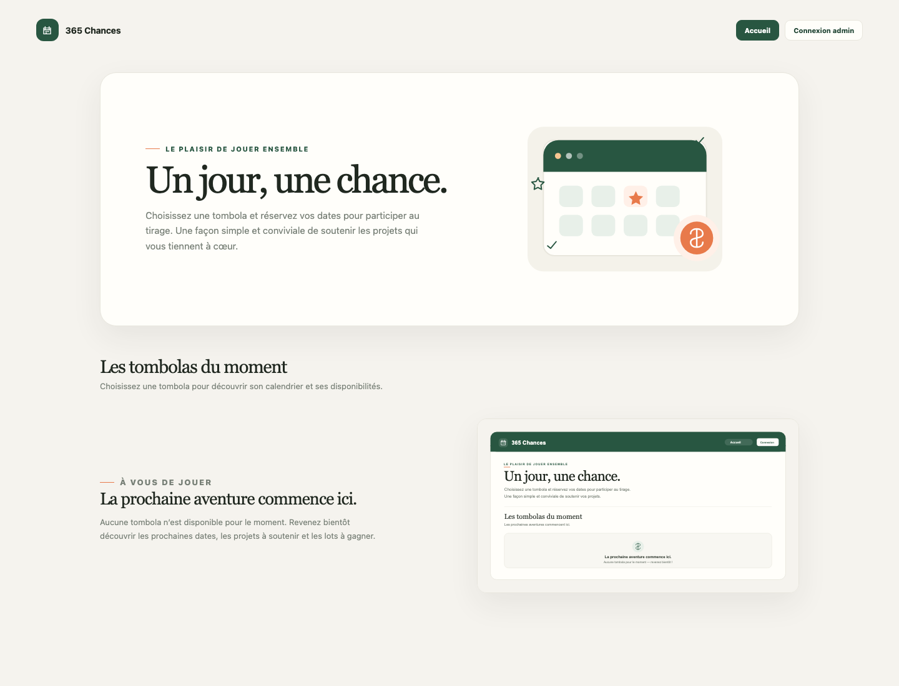

# 365 Chances

Application web pour gérer plusieurs tombolas annuelles : calendrier configurable par année, réservation publique des dates avec paiement PayPal, liste des acheteurs protégée par un compte administrateur, personnalisation des titres, descriptions, couleurs et logos, et tirage aléatoire. Chaque date correspond à une participation de **2 €**. Les paiements sont confirmés par le serveur auprès de PayPal avant l’enregistrement définitif ; une date est bloquée pendant 15 minutes au cours du paiement.



## Fonctionnalités

- Page d’accueil répertoriant les tombolas disponibles, avec calendrier accessible après leur sélection.
- Calendrier public permettant de choisir une date disponible et de payer 2 € par PayPal ; les dates réservées ou en cours de paiement sont indisponibles.
- Connexion administrateur par identifiant et mot de passe, avec comptes enregistrés en base et mots de passe hachés.
- Inscription de comptes facultative via `ALLOW_ADMIN_SIGNUP` ; les nouveaux comptes doivent valider leur adresse email via SMTP avant de se connecter.
- Espace admin pour gérer plusieurs tombolas, choisir leur année de calendrier et personnaliser leur titre, description, couleurs et logo, ajouter des réservations, consulter les acheteurs, libérer une date et lancer le tirage.
- Base SQLite persistante dans un volume Docker.
- Application accessible sur le port local 8080, à relier à Nginx Proxy Manager pour le domaine et le HTTPS.
- Limitation des tentatives de connexion, sessions sécurisées, protection CSRF et en-têtes de sécurité.

## Prérequis VPS

- Un VPS Linux récent avec Docker Engine et le plugin Docker Compose.
- Un nom de domaine ou sous-domaine pointant vers l’adresse IP du VPS.
- Nginx Proxy Manager configuré sur le VPS et relié au port 8080 de l’hôte.
- Git installé sur le VPS.

Le dépôt GitHub héberge le code source. L’application elle-même fonctionne sur votre VPS ; elle n’est pas publiée sur GitHub Pages, car elle nécessite le serveur Flask et la base SQLite.

## Déploiement

1. Dans GitHub, créez un dépôt **privé** et poussez-y les fichiers de ce projet. N’ajoutez jamais le fichier `.env` au dépôt.
2. Connectez le DNS de votre domaine à l’IP du VPS avec un enregistrement A (et un AAAA uniquement si IPv6 est configuré). Dans Nginx Proxy Manager, créez un Proxy Host vers l’adresse du VPS sur le port `8080` et configurez votre certificat TLS. Restreignez l’accès externe au port `8080` avec le pare-feu du VPS afin que l’application soit utilisée via Nginx Proxy Manager.
3. Connectez-vous au VPS et clonez le dépôt :

   ```sh
   git clone https://github.com/ludovicmorisset/365Chances.git 365Chances
   cd 365Chances
   cp .env.example .env
   ```

4. Créez des secrets forts puis éditez `.env`. Exemple pour générer les valeurs :

   ```sh
   openssl rand -base64 36
   openssl rand -base64 48
   ```

   Utilisez une valeur différente pour chaque clé. `ADMIN_USERNAME`, `ADMIN_EMAIL` et `ADMIN_PASSWORD` définissent le compte administrateur initial ; son mot de passe doit faire au moins 16 caractères. Les comptes créés sur le site doivent utiliser un mot de passe d’au moins 12 caractères, et `SESSION_SECRET` doit en faire au moins 32. Pour autoriser l’inscription, réglez `ALLOW_ADMIN_SIGNUP=true`, puis configurez `PUBLIC_URL`, `SMTP_HOST`, `SMTP_PORT`, `SMTP_USERNAME`, `SMTP_PASSWORD`, `SMTP_FROM` et `SMTP_USE_TLS`. Gardez `.env` privé et limité aux permissions du propriétaire :

   ```sh
   chmod 600 .env
   ```

5. Démarrez l’application et vérifiez son état :

   ```sh
   docker compose up -d --build
    docker compose ps
    docker compose logs -f tombola


   ```

6. Ouvrez `https://VOTRE-DOMAINE`, puis choisissez **Connexion admin** et utilisez `ADMIN_USERNAME` et `ADMIN_PASSWORD`. Le compte défini au déploiement est créé et validé automatiquement au démarrage.

Nginx Proxy Manager gère le certificat HTTPS. Le port applicatif `8080` doit être bloqué pour les connexions externes dans le pare-feu ; le cookie de session est limité à HTTPS.

## Configuration des paiements PayPal

1. Créez une application API dans le tableau de bord développeur PayPal et copiez son Client ID ainsi que son Secret dans le fichier `.env` sur le serveur.
2. Gardez `PAYPAL_ENVIRONMENT=sandbox` pour les essais ; après validation des achats tests, réglez `PAYPAL_ENVIRONMENT=live` et utilisez les identifiants de l’application PayPal Live.
3. Créez un webhook PayPal vers `https://VOTRE-DOMAINE/api/payments/paypal/webhook` pour l’événement `PAYMENT.CAPTURE.COMPLETED`, puis ajoutez son ID dans `PAYPAL_WEBHOOK_ID`.
4. Redémarrez l’application avec `docker compose up -d --build`. Sans identifiants PayPal, le calendrier reste consultable mais l’achat public est désactivé.
5. La création et la capture des paiements se font côté serveur. L’application valide la signature du webhook ainsi que le montant et l’état de la commande PayPal avant de réserver la date.

Les identifiants PayPal sont des secrets : ne les partagez pas et ne les ajoutez jamais au dépôt Git. Les remboursements restent à traiter depuis le compte PayPal.

## Mises à jour

Depuis le répertoire cloné sur le VPS :

```sh
git pull
docker compose up -d --build
```

Le volume `tombola_data` n’est pas supprimé par une reconstruction de l’image.

## Sauvegarde et restauration

Sauvegardez régulièrement la base SQLite, ainsi que le fichier `.env` dans un coffre sécurisé. Exemple de sauvegarde cohérente pendant que le conteneur tourne :

```sh
docker compose exec -T tombola python -c 'import os, sqlite3; src=sqlite3.connect("/data/tombola.sqlite3"); dst=sqlite3.connect("/tmp/tombola-backup.sqlite3"); src.backup(dst); dst.close(); src.close()'
docker compose cp tombola:/tmp/tombola-backup.sqlite3 ./tombola-backup.sqlite3
```

Conservez la sauvegarde en dehors du VPS et protégez-la : elle contient des noms et numéros de téléphone.

Pour restaurer, arrêtez l’application, copiez la sauvegarde dans le volume `tombola_data` à l’emplacement `/data/tombola.sqlite3`, puis redémarrez-la. Ne lancez jamais `docker compose down -v` pour un arrêt normal : l’option `-v` supprime les volumes et donc les réservations.

## Administration et données personnelles

- Les noms et téléphones ne sont renvoyés qu’aux sessions administrateur authentifiées.
- Le public ne voit que l’état disponible/réservé des dates.
- Une date libérée redevient immédiatement réservable par l’administrateur ; notez séparément tout remboursement ou paiement à traiter.
- Le tirage choisit uniformément une réservation et affiche le nom, la date et le numéro au compte admin.
- Le mot de passe est conservé dans `.env`, pas dans Git. Pour le changer, modifiez `.env` puis recréez le conteneur : `docker compose up -d --force-recreate tombola`.
- Restreignez l’accès VPS, gardez Docker et le système à jour, et appliquez vos obligations de protection des données (information des participants, durée de conservation et suppression).

## Architecture

- `index.html` : accueil, interface publique et admin.
- `app.py` : API Flask, sessions et gestion SQLite.
- `Dockerfile` et `requirements.txt` : image de l’application.
- `docker-compose.yml` : application et stockage persistant ; Nginx Proxy Manager fournit le proxy HTTPS séparément.
- `.env.example` : modèle de configuration ; copiez-le en `.env` sur le serveur.
